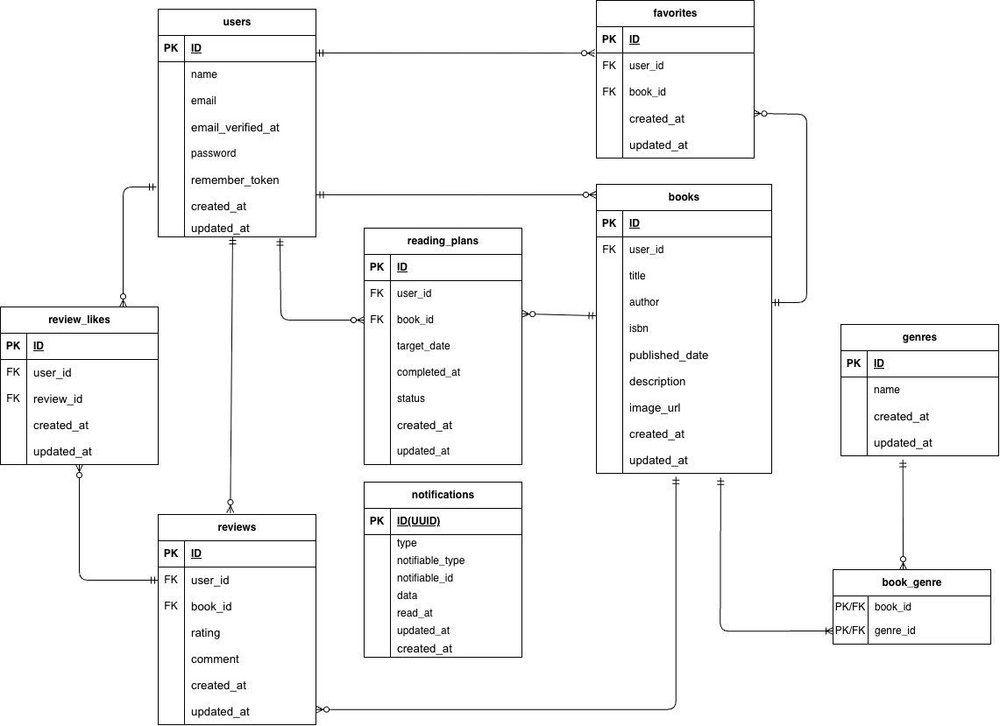

# Bookshelf

書籍レビューアプリ

## アプリケーション概要

- このアプリは、書籍レビューアプリケーションです。ユーザーは書籍を登録、閲覧しレビューの投稿やお気に入り登録ができます。書籍登録の際には、ISBN-13によるGoogle Books API連携（書籍情報自動取得）にて、書籍情報を取得する機能を備え、その情報をもとに書籍を登録することができます。また、登録された書籍の検索機能として、キーワード、ジャンルでの検索、及び、並び順（新しい、古い、評価、タイトル、）での検索機能を備えています。-マイ読書レポートにて、ユーザーのレビュー評価平均化による書籍順位や、ジャンル別での評価ランキングを一覧で確認することが可能です。
- 読書計画機能にて、書籍の読書計画を管理し、リマインダー通知機能にて、読書計画に応じた期日に沿って、ユーザーへの通知を実施します。
- 外部アプリケーション向けの公開API(JSON、認証機能あり)を提供します。

## ER図



## 環境構築手順

1. リポジトリのクローン

以下のコマンドでGitHubからリポジトリをクローンします。

```bash
git clone https://github.com/aokiaiko/bookshelf-app.git
```

プロジェクトディレクトリに移動します。

```bash
cd bookshelf-app
```

2. Composerの依存パッケージのインストール

Dockerを使用して、Laravelの依存パッケージをインストールします。

```bash
docker run --rm \
 -u "$(id -u):$(id -g)" \
 -v "$(pwd):/var/www/html" \
 -w /var/www/html \
 -e COMPOSER_CACHE_DIR=/tmp/composer_cache \
 laravelsail/php82-composer:latest \
 composer install
```

3. 環境変数の設定

.env.example をコピーして .env ファイルを作成します。

```bash
cp .env.example .env
```

.env ファイルを開き、データベースの接続情報を設定します。

```env
DB_CONNECTION=mysql
DB_HOST=mysql
DB_PORT=3306
DB_DATABASE=laravel
DB_USERNAME=sail
DB_PASSWORD=任意のパスワード
```

DB_HOST は localhost や 127.0.0.1 ではなく、Dockerコンテナ名である mysql を指定します。
.env の DB_PASSWORD に設定した値が、MySQLコンテナの初回起動時にパスワードとして使用されます。

※ Google Books APIのAPIキー
Google Books APIのAPIキーを取得し .env に以下のように設定してください。

```env
GOOGLE_BOOKS_API_KEY=取得したAPIキー
```

4. Laravel Sailの起動

以下のコマンドでDockerコンテナをバックグラウンドで起動し、Sailのエイリアスを設定します。

```bash
./vendor/bin/sail up -d
```

エイリアスを設定して 'sail' だけでコマンドを実行できるようにします。

```bash
echo "alias sail='[ -f sail ] && bash sail || bash vendor/bin/sail'" >> ~/.zshrc
```

シェルを再起動してエイリアスを有効にします。

```bash
exec $SHELL
```

- アプリケーションキーの生成

```bash
sail artisan key:generate
```

- データベースのマイグレーションと初期データ投入

```bash
sail artisan migrate --seed
```

- フロントエンドのセットアップ
  npmの依存パッケージをインストールします。

```bash
sail npm install
```

Vite開発サーバーを起動します。

```bash
sail npm run dev
```

開発中はVite開発サーバーを起動した状態にしてください。

## 使用技術

- PHP 8.5.12
- Laravel 10.50.3
- MySQL 8.4.13
- Docker / Laravel Sail
- Vite
- Tailwind CSS 3.4
- Alpine.js
- Laravel Sanctum
- Xdebug 3.5.3（テストカバレッジ測定）

## 作成者

青木愛子

## API エンドポイント一覧

- GET /api/v1/books 書籍一覧を取得する
- GET /api/v1/books/{book} 書籍詳細を取得する
- POST /api/v1/books 書籍を新規登録する (認証あり)
- PUT /api/v1/books/{book} 書籍を更新する　(認証あり)
- DELETE /api/v1/books/{book} 書籍を削除する　(認証あり)

## 開発環境URL

- **開発環境** : http://localhost/
- **phpMyAdmin** : http://localhost:8080/

## Sanctum認証について

書籍一覧・詳細取得APIは認証不要です。
書籍の登録・更新・削除APIは、Laravel SanctumによるBearerトークン認証が必要です。

- APIトークンの発行
  既存のWeb登録ユーザーに対して、Laravel Tinkerを使用してAPIトークンを発行します。
  以下のコマンドでTinkerを起動します。

```bash
sail artisan tinker
```

登録済みユーザーを取得します。

```php
$user = App\Models\User::find(1);
```

※ `1` は登録済みユーザーのIDに置き換えてください。

APIトークンを発行します。

```php
$token = $user->createToken('api-token')->plainTextToken;
```

発行されたトークンを表示します。

```php
$token;
```

- APIへのアクセス
  PostmanなどのAPIクライアントで、AuthorizationヘッダーにBearerトークンを設定します。

```http
Authorization: Bearer 発行したトークン
```

このトークンを使用することで、書籍の登録・更新・削除APIにアクセスできます。
※ APIトークンは第三者に公開しないでください。

## バッチ処理

Bookshelfアプリでは以下の2種類のバッチ処理を実装しています。

- 読書計画の期限超過によるステータス更新
- 読書計画の期日に応じたリマインダー通知
  2種類とも毎日20時に実行する設定となっています。通知機能実施の際はスケジューラー起動にてバッチ処理を実施します。以下のコマンドで実施してください。

```bash
sail artisan schedule:work
```

## テスト

- 以下のコマンドでテストを実施してください。

```bash
sail artisan test
```

- テストカバレッジの確認は以下のコマンドで実施してください。

```bash
sail artisan test --coverage
```

※ カバレッジ測定ができない場合は、Xdebugのcoverageモードを有効にする必要があります。.env に以下を設定します

```env
SAIL_XDEBUG_MODE=coverage
```

設定後、sailを再起動しテストカバレッジを再度測定してください。

```bash
sail down
sail up -d
sail artisan test --coverage
```
